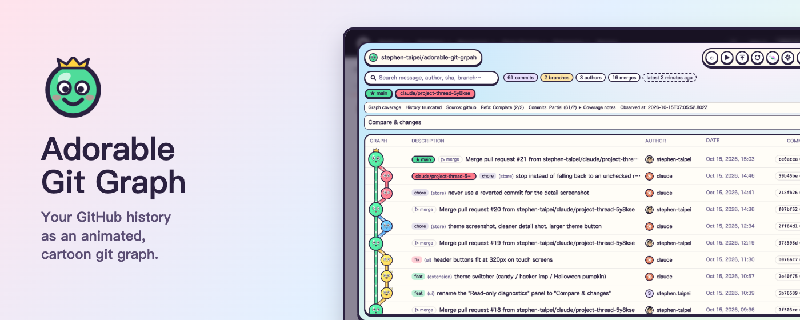
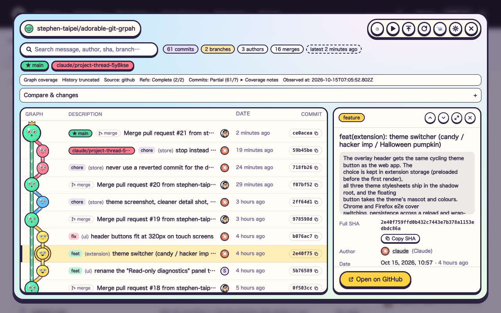
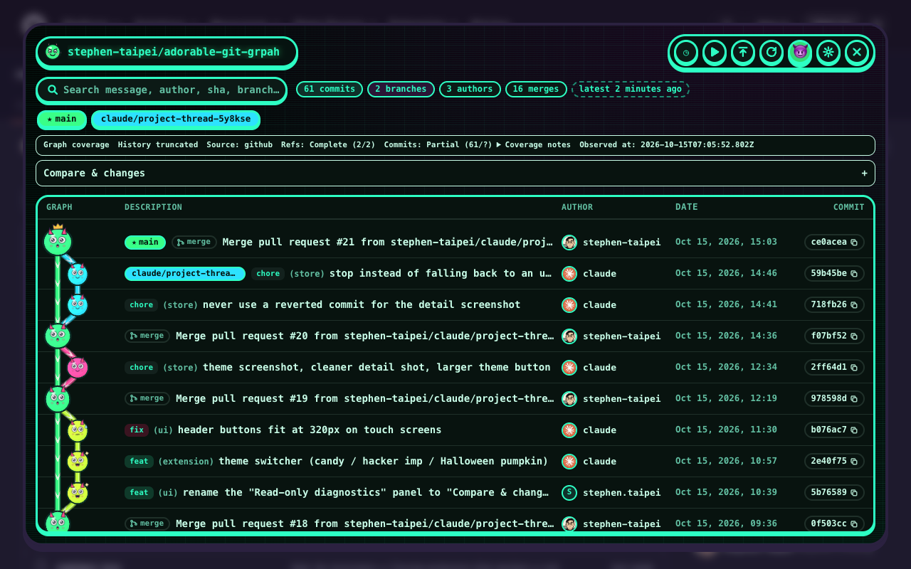

<div align="center">

# Adorable Git Graph

**Your git history, as a cartoon you can scroll.**

An animated, three.js git graph for GitHub repositories and your local repos: every commit is a little ball with a face, every branch a flowing pipe. Read-only, no server of ours.

[](https://github.com/stephen-taipei/adorable-git-graph/releases/latest)
[](https://www.npmjs.com/package/@stephen.taipei/adorable-git-graph)
[](#chrome-extension)
[](#firefox-add-on)
[](LICENSE)
[](https://github.com/stephen-taipei/adorable-git-graph/actions/workflows/ci.yml)

**English** · [繁體中文](README.zh-TW.md)

</div>

**[Live demo](https://stephen-taipei.github.io/adorable-git-graph/)**: try it in the browser, no install. It shows this repo's own history; the GitHub tab opens any public repo.

[Install](#install) · [What you see](#what-you-see) · [Themes](#themes) · [Keyboard](#keyboard) · [Privacy and safety](#privacy-and-safety) · [Development](#development) · [Limitations](#known-limitations) · [Detailed docs](docs/development.md)



## What it does

Adorable Git Graph draws a repository's history as a `git log --graph` style list, newest on top, with a cartoon graph next to it. It comes in three forms that share one UI:

| Form                                                 | Where it runs                              | Reads from                         |
| ---------------------------------------------------- | ------------------------------------------ | ---------------------------------- |
| [Chrome extension](#chrome-extension)                | A button on any github.com repository page | GitHub REST API                    |
| [Firefox add-on](#firefox-add-on)                    | Same as Chrome, same source code           | GitHub REST API                    |
| [`npx @stephen.taipei/adorable-git-graph`](#npm-cli) | `localhost` in your browser                | Local `git` (plus any GitHub repo) |

- Commits are balls whose face follows the commit type: `feat` laughs, `fix` sweats, merges are bigger, the root sprouts, the tip of the default branch wears a crown.
- Each row shows branch / tag / HEAD labels, merge marks, conventional-commit type, author, date and short SHA (click to copy).
- Search, branch focus, commit details, infinite scroll for older history, light and dark schemes, phone to desktop layouts.
- **Compare & changes** panel: pick base and head, see the commits unique to each side, changed files and a lazy diff, with a summary that keeps the SHAs. See [docs/rd-diagnostics.md](docs/rd-diagnostics.md).

## Install

### Chrome extension

Chrome Web Store and Firefox Add-ons listings are under review. Until they are live, load the extension from source:

```bash
pnpm install
pnpm build                     # → apps/extension/dist
```

Open `chrome://extensions`, turn on **Developer mode**, choose **Load unpacked** and pick `apps/extension/dist`. Then open any GitHub repository and click the **Git Graph** button in the bottom-right corner, or the toolbar icon.

> [!NOTE]
> GitHub tabs that were already open need one reload before the button appears.

### Firefox add-on

Requires Firefox 140 or newer.

```bash
pnpm install
pnpm --filter @adorable/extension-firefox build   # → apps/extension-firefox/dist
```

Open `about:debugging#/runtime/this-firefox`, choose **Load Temporary Add-on…** and pick `apps/extension-firefox/dist/manifest.json`. The add-on is removed when Firefox closes.

### npm CLI

For your local repositories, no clone of this project needed. Requires Node.js 22+ and `git`.

```bash
cd your-repo
npx @stephen.taipei/adorable-git-graph
```

- **Live:** commit, switch branches or fetch in your terminal, and new commits pop in without a reload.
- **Other repos:** pick sibling repos from the menu, or open any path on your computer.
- Listens on `127.0.0.1` only. Options and environment variables: [apps/cli/README.md](apps/cli/README.md).

### Web app from source

```bash
pnpm install
pnpm start                       # http://localhost:4200, shows this project
pnpm start --repo ~/code/repo    # show another local repo
```

Same screen as the CLI, served by the Vite dev server. Details: [docs/development.md](docs/development.md#web-apppnpm-start).

## What you see



| Area              | What it does                                                                                                                        |
| ----------------- | ----------------------------------------------------------------------------------------------------------------------------------- |
| Graph column      | One lane per branch, default branch on the left; forks and merges turn with S-curves                                                |
| Rows              | Branch / tag / HEAD labels (★ default, ☁ remote, ⚑ tag), type tag, author, date, short SHA                                          |
| Toolbar           | Search (message, author, SHA, branch, tag; all words must match), stats, branch filter with "ahead of default" count                |
| Details           | Full message and SHA, parents / children, branches that contain the commit, previous / next, Open on GitHub; ⤢ toggles a wide panel |
| Header buttons    | Replay the intro animation, back to newest, refetch, switch theme, settings                                                         |
| Compare & changes | Base / head comparison, changed files, lazy diff, SHA-stamped summary                                                               |

The layout follows the viewer's own width: details sit beside the list on wide screens, slide in as a drawer on medium ones, and become a bottom sheet on phones. `prefers-reduced-motion` is respected.

## Themes

Three themes, each with a light and a dark scheme. The choice is remembered.

| Candy                                           | Hacker imp                                                   | Halloween pumpkin                                                 |
| ----------------------------------------------- | ------------------------------------------------------------ | ----------------------------------------------------------------- |
| The default: pastel colors, a green blob mascot | Neon terminal colors, an imp mascot, commit balls grow horns | Orange and purple, a pumpkin mascot, commit balls wear witch hats |



## Keyboard

| Key                     | Action                                                          |
| ----------------------- | --------------------------------------------------------------- |
| `↑` `↓` / `j` `k`       | Select previous / next commit                                   |
| `Home` `End`            | Jump to newest / oldest loaded                                  |
| `/`                     | Search                                                          |
| `Enter` / `Shift+Enter` | Next / previous search match                                    |
| `Esc`                   | Close one layer: details → search text → branch focus → overlay |

## Privacy and safety

- **Read-only.** No git write operations, anywhere.
- **What leaves your machine:** the extensions talk only to `api.github.com` and GitHub's avatar images. The CLI and web app run read-only `git` commands locally, and call `api.github.com` from your browser only when you switch to a GitHub repo.
- **No analytics, no tracking, no servers of ours.** Full policy: [PRIVACY.md](PRIVACY.md).
- **Optional token:** a fine-grained GitHub PAT raises the limit from 60 to 5,000 requests an hour and unlocks private repos. Grant only `Contents: Read-only` and `Metadata: Read-only`. The token stays in the extension's local storage, is read only by the background script, and is sent only as an `Authorization` header to `api.github.com`; pages and content scripts never see it.
- **Minimal permissions:** `storage` plus `https://api.github.com/*`; the content script matches only `https://github.com/*`.
- **Local server:** binds to `localhost` / `127.0.0.1` and answers its data endpoints only to same-origin requests from this machine.

> [!WARNING]
> A static build (`pnpm --filter @adorable/web build`) bakes commit subjects, author names and branch / tag names into the bundle. Do not deploy a build of a private repo publicly.

## Development

Requires Node.js ≥ 22.18 and pnpm (version pinned in `packageManager`).

```bash
pnpm install
pnpm start          # web app on http://localhost:4200
pnpm dev            # Chrome extension watch build
pnpm dev:firefox    # Firefox extension watch build
pnpm typecheck
pnpm test           # vitest
pnpm build          # all apps
pnpm e2e            # real-browser end-to-end: Chrome extension, web app, Firefox add-on
```

Chrome e2e and store screenshots need Chromium, because Google Chrome 137+ ignores `--load-extension`. Run `pnpm --filter @adorable/extension exec playwright-core install chromium` once.

```
apps/
  web/                 Vite + React app behind pnpm start
  extension/           Chrome MV3 build entry, icons, e2e
  extension-firefox/   Firefox MV3 build entry, web-ext lint / package, e2e
  cli/                 npm package @stephen.taipei/adorable-git-graph
libs/
  extension-core/      Shared extension: background, content script, options page, manifest
  graph-core/          Pure TS: types, lane layout, GitHub client, git log parser
  graph-ui/            three.js scene + React GitGraphViewer, themes
tools/e2e/             Shared e2e helpers: mock GitHub API, fake github.com pages
```

Everything else lives in [docs/development.md](docs/development.md) (Traditional Chinese): how the graph is laid out and drawn, every web app option and environment variable, the e2e coverage, and the Chrome Web Store / AMO release steps. Store listing text is in [docs/store-listing.md](docs/store-listing.md).

## Known limitations

- The GitHub source reads about 60 commits per branch first; older history loads as you scroll, and each batch costs API calls.
- Without a token the GitHub API allows 60 requests an hour, so opening several repos in a row hits the rate limit.
- github.com only: no GitHub Enterprise or GitLab. The local source works with any git repo.
- The repo picker exists only in the CLI and `pnpm start`; the extensions read GitHub, not local repos.
- No horizontal layout or free zoom, on purpose, in exchange for consistent scrolling, search and responsive layout.
- Animation drops frames on software WebGL (no GPU).
- The Firefox add-on is tested on recent Firefox for Linux and macOS. Firefox 140 (the minimum), Windows and Firefox for Android are untested.

## License

[Apache-2.0](LICENSE) · [Privacy policy](PRIVACY.md) · Made and maintained by [stephen-taipei](https://github.com/stephen-taipei).
